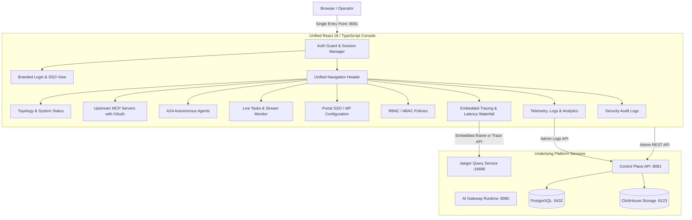
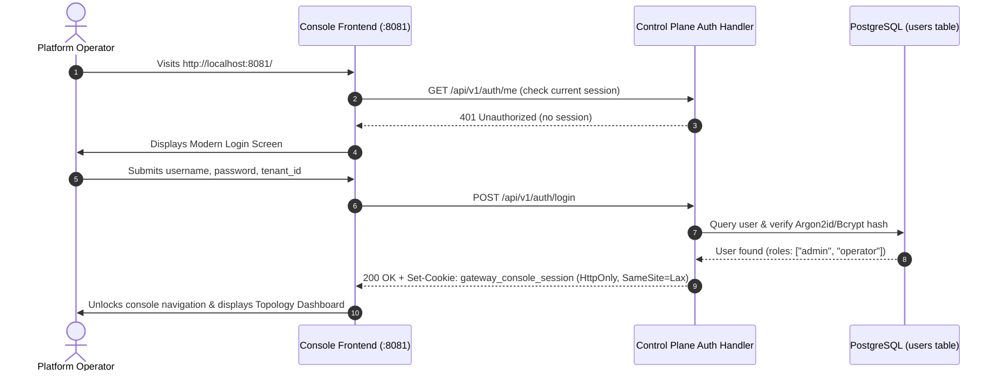
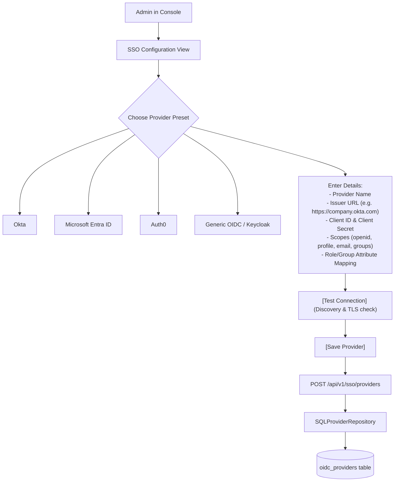
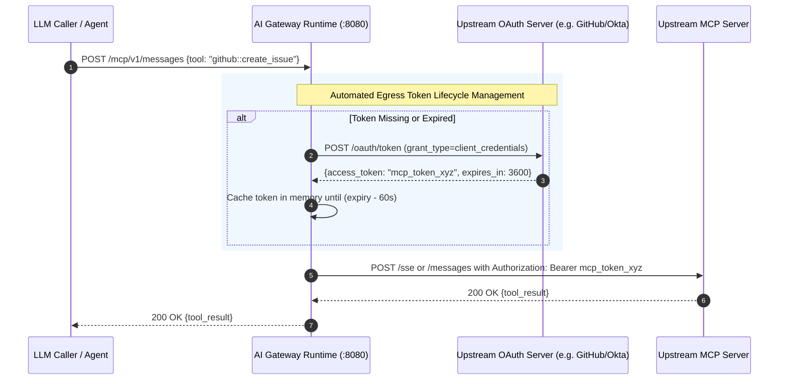

# AI Gateway Platform: Portal Security, SSO Configuration, MCP OAuth & Portal Unification Plan

This document details the architectural plan, technical specifications, and step-by-step implementation roadmap for:
1. **Protecting the AI Gateway Management Console** with username and password authentication.
2. **Self-Service Portal SSO Configuration** enabling operators to federate with any external Identity Provider (Okta, Auth0, Microsoft Entra ID, Google, Keycloak).
3. **Upstream MCP Server OAuth 2.0 Support** enabling secure integration with OAuth2-protected Model Context Protocol tools.
4. **Portal Unification ("Clouding Together")** consolidating disparate tools (Console, Jaeger UI, Login/Consent, Telemetry) into a single unified web experience.

---

## 1. Architectural Consultation: Portal Unification Strategy

### Current Fragmented Architecture
Currently, operators and developers encounter multiple fragmented endpoints across different ports:
- `http://localhost:8081`: Management Console (React Single Page Application)
- `http://localhost:16686`: Jaeger UI (Standalone distributed tracing web application)
- `http://localhost:8080/login` & `/consent`: Gateway Identity Provider pages (unstyled raw HTML)
- `http://localhost:8123/play`: ClickHouse Play (raw SQL query console)
- `http://localhost:9090/metrics`: Prometheus metrics exposition endpoint

### Target Unified Architecture
Consolidate all administrative and developer experiences under **a single unified portal** hosted by the Control Plane at `http://localhost:8081` (or reverse-proxied behind `:8080/console`):

#### Key Unification Benefits:
1. **Single Sign-On (SSO):** A single login session protects management views, telemetry analytics, and tool catalogs.
2. **Integrated Tracing:** The existing [TraceWaterfall.tsx](file:///c:/Users/Administrator/Downloads/project/project_alpha/web/src/components/TraceWaterfall.tsx) and an embedded Jaeger view are accessible within the same tabbed navigation without opening separate browser tabs.
3. **No Direct Database Exposure:** Operators query logs through the secure [LogSearch.tsx](file:///c:/Users/Administrator/Downloads/project/project_alpha/web/src/components/LogSearch.tsx) component rather than exposing raw ClickHouse Play on port `:8123`.
4. **Consistent Aesthetics:** Raw HTML login/consent forms are replaced with branded React components.

---

## 2. Feature 1: Console Username & Password Authentication

### 2.1 Overview & Request Flow
The Management Console will require authentication before any administration view is rendered.

### 2.2 Technical Specifications

#### Database & Initial Admin Credentials
- Table [users](file:///c:/Users/Administrator/Downloads/project/project_alpha/migrations/000008_users.up.sql) already exists with:
  - `id`, `tenant_id`, `username`, `email`, `password_hash`, `roles`, `active`.
- [dev-seed](file:///c:/Users/Administrator/Downloads/project/project_alpha/cmd/dev-seed/main.go) and bootstrap scripts will provision a default administrator account:
  - **Tenant ID:** `default`
  - **Username:** `admin`
  - **Password:** Configurable via environment variable `GATEWAY_ADMIN_INITIAL_PASSWORD` (defaults to a secure dev password with force-change prompt on first login).

#### Control Plane API Endpoints ([cmd/control-plane/main.go](file:///c:/Users/Administrator/Downloads/project/project_alpha/cmd/control-plane/main.go))
| Method | Endpoint | Description |
| :--- | :--- | :--- |
| `POST` | `/api/v1/auth/login` | Authenticates username & password; sets secure session cookie. |
| `POST` | `/api/v1/auth/logout` | Clears session cookie and invalidates session. |
| `GET` | `/api/v1/auth/me` | Returns current user identity, tenant, and assigned roles. |

#### Control Plane Auth Middleware
- Protects all `/api/v1/*` endpoints (excluding `/api/v1/auth/login`, `/healthz`, `/readyz`).
- Verifies session token or Bearer JWT and injects `Principal` into Go `context.Context`.

#### Frontend Components
- `web/src/components/LoginView.tsx`: Modern dark-mode login form with tenant selection, error feedback, and "Sign in with SSO" option.
- `web/src/context/AuthContext.tsx`: React Context managing user authentication state, auto session refresh, and logout handlers.
- Update [App.tsx](file:///c:/Users/Administrator/Downloads/project/project_alpha/web/src/App.tsx) with route guards.

---

## 3. Feature 2: Portal SSO / IdP Configuration Page

### 3.1 Overview & Request Flow
Once logged in as an administrator, operators can navigate to the **SSO & Identity** view to configure external Identity Providers using OpenID Connect (OIDC).

### 3.2 Technical Specifications

#### Database Layer
- Table [oidc_providers](file:///c:/Users/Administrator/Downloads/project/project_alpha/migrations/000007_oidc_providers.up.sql) already exists with:
  - `id`, `tenant_id`, `name`, `issuer_url`, `client_id`, `client_secret_hash`, `claim_mapping`, `active`.
- [SQLProviderRepository](file:///c:/Users/Administrator/Downloads/project/project_alpha/internal/identity/oidc/sql_repository.go) provides data access methods:
  - `SaveProvider(ctx, provider)`
  - `GetProvider(ctx, tenantID, id)`
  - `ListProviders(ctx, tenantID)`

#### Admin REST API Endpoints
| Method | Endpoint | Description |
| :--- | :--- | :--- |
| `GET` | `/api/v1/sso/providers` | Lists configured external IdPs for the tenant. |
| `POST` | `/api/v1/sso/providers` | Creates or updates an external IdP configuration. |
| `DELETE` | `/api/v1/sso/providers/:id` | Deletes or deactivates an IdP configuration. |
| `POST` | `/api/v1/sso/providers/:id/test` | Live test: downloads `/.well-known/openid-configuration` and checks endpoint connectivity. |

#### Frontend View: `web/src/components/SSOConfigView.tsx`
- **Provider Catalog:** Cards showing configured providers with status badges (`Active`, `Testing`, `Disabled`).
- **Configuration Modal / Drawer:**
  - Presets for Okta, Entra ID, Auth0, Google Workspace, and Custom OIDC.
  - Issuer URL, Client ID, Client Secret (masked input).
  - Claim Mapping Editor (e.g., mapping IdP `groups: ["platform-admins"]` to platform role `admin`).
  - Single-click **"Test Discovery"** button that validates the configuration before saving.
  - Toggle switch: **"Enable SSO on Console Login Screen"**.

---

## 4. Feature 3: Upstream MCP Server OAuth 2.0 Support

### 4.1 The Identified Gap
In [MCPServersView.tsx](file:///c:/Users/Administrator/Downloads/project/project_alpha/web/src/components/MCPServersView.tsx#L247-L305), the registration modal only requests server name, prefix, transport type, endpoint URL, timeout, and concurrency. **Authentication configuration is completely absent from the UI**, preventing upstream tools (like GitHub, Jira, Salesforce, AWS, or custom MCP servers) from authenticating via OAuth 2.0.

### 4.2 Upstream MCP OAuth Architecture

### 4.3 Technical Specifications

#### Authentication Modes to Support in UI & Gateway
1. **`NONE`**: Public or local stdio tools.
2. **`BEARER_TOKEN`**: Static Personal Access Tokens (PAT) or API keys.
3. **`BASIC`**: Username and password.
4. **`OAUTH2_CLIENT_CREDENTIALS`**: Automated Machine-to-Machine (M2M) upstream token acquisition:
   - **Token Endpoint URL:** (e.g., `https://oauth2.provider.com/token`)
   - **Client ID & Client Secret**
   - **Scopes:** Space-separated OAuth scopes required by the tool.
   - **Audience:** Optional resource audience identifier.
5. **`OAUTH2_TOKEN_EXCHANGE` (RFC 8693)**:
   - Exchanges the inbound caller's JWT token for a scoped downstream upstream token.

#### Data Persistence & Encryption
- In [000001_init_schema.up.sql](file:///c:/Users/Administrator/Downloads/project/project_alpha/migrations/000001_init_schema.up.sql#L56-L57), table `mcp_servers` already contains:
  - `auth_type TEXT NOT NULL DEFAULT 'NONE'`
  - `encrypted_auth_credentials BYTEA`
- Credentials will be JSON-serialized and encrypted using AES-256-GCM via the platform's `GATEWAY_ENCRYPTION_KEY`.

#### Gateway Egress Token Manager ([internal/mcp/upstream/](file:///c:/Users/Administrator/Downloads/project/project_alpha/internal/mcp/upstream/))
- Implements an automated token provider with:
  - In-memory thread-safe caching (`sync.RWMutex`).
  - Proactive background renewal before token expiry.
  - Automatic `Authorization: Bearer <token>` header injection on outbound HTTP/SSE requests.

#### Frontend Updates in [MCPServersView.tsx](file:///c:/Users/Administrator/Downloads/project/project_alpha/web/src/components/MCPServersView.tsx)
- Add **Authentication Type** dropdown to the registration modal.
- Conditionally render OAuth2 configuration fields when `OAUTH2_CLIENT_CREDENTIALS` is chosen:
  - Token Endpoint input field.
  - Client ID & Client Secret fields (password-masked).
  - Scopes input with helpful placeholder.
  - Audience input.
- Display an **Auth Badge** in the server table: `OAuth2 (M2M)`, `Bearer`, or `None`.

---

## 5. Detailed Implementation Phases & Milestones

### Phase 1: Management Console Authentication
- [x] **1.1 Backend Auth Controller:**
  - Implemented `internal/api/admin/auth.go` with `/api/v1/auth/login`, `/logout`, and `/me`.
  - Implemented signed ES256 session tokens with `gateway_console_session` HttpOnly cookie.
  - Added unit test suite in `internal/api/admin/auth_test.go` (100% pass).
- [x] **1.2 Auth Middleware:**
  - Added session cookie and Bearer token verification in `internal/api/middleware/auth.go` and mounted routes in [cmd/control-plane/main.go](file:///c:/Users/Administrator/Downloads/project/project_alpha/cmd/control-plane/main.go) protecting `/api/v1/*`.
- [x] **1.3 Seed & Bootstrap Default Admin:**
  - Configured automatic startup bootstrap in [cmd/control-plane/main.go](file:///c:/Users/Administrator/Downloads/project/project_alpha/cmd/control-plane/main.go) and [cmd/dev-seed/main.go](file:///c:/Users/Administrator/Downloads/project/project_alpha/cmd/dev-seed/main.go) provisioning tenant `tenant-1` and admin (`admin` / `admin123`).
- [x] **1.4 Frontend Auth State & Login View:**
  - Built `web/src/components/LoginView.tsx` with dark theme, loading state, error alerts, and credentials hint.
  - Updated [App.tsx](file:///c:/Users/Administrator/Downloads/project/project_alpha/web/src/App.tsx) with session verification, unauthenticated route guard, and logout handling.
  - Added user profile badge (`username` + `role`) and "Sign Out" button to [Navbar.tsx](file:///c:/Users/Administrator/Downloads/project/project_alpha/web/src/components/Navbar.tsx).
  - Verified live end-to-end authentication via automated test script.

### Phase 2: Portal SSO / IdP Configuration
- [x] **2.1 Admin SSO Endpoints:**
  - Implemented `internal/api/admin/sso.go` utilizing [SQLProviderRepository](file:///c:/Users/Administrator/Downloads/project/project_alpha/internal/identity/oidc/sql_repository.go).
  - Added connection test utility validating remote `.well-known/openid-configuration` via [Discoverer](file:///c:/Users/Administrator/Downloads/project/project_alpha/internal/identity/oidc/discovery.go).
  - Added unit tests in `internal/api/admin/sso_test.go` (100% pass).
- [x] **2.2 Frontend SSO Settings:**
  - Created `web/src/components/SSOConfigView.tsx` with quick-start templates (Okta, Microsoft Entra ID, Auth0, Google Workspace, Keycloak), claim mapping editor, discovery testing, and login simulation.
  - Added "SSO & Identity" navigation link in [Navbar.tsx](file:///c:/Users/Administrator/Downloads/project/project_alpha/web/src/components/Navbar.tsx) and mounted in [App.tsx](file:///c:/Users/Administrator/Downloads/project/project_alpha/web/src/App.tsx).
  - Connected provider creation, listing, editing, deletion, and live connection testing to the API.
- [x] **2.3 Console SSO Login Integration:**
  - Updated [LoginView.tsx](file:///c:/Users/Administrator/Downloads/project/project_alpha/web/src/components/LoginView.tsx) to query active public SSO providers and render federated SSO sign-in options.
  - Implemented `/api/v1/auth/sso/simulate` for instant end-to-end token exchange and role mapping validation.

### Phase 3: Upstream MCP Server OAuth 2.0 Support
- [x] **3.1 Frontend MCP Registration & Probe UI:**
  - Expanded [MCPServersView.tsx](file:///c:/Users/Administrator/Downloads/project/project_alpha/web/src/components/MCPServersView.tsx) to support Authentication Method selection (`NONE`, `OAUTH2_CLIENT_CREDENTIALS`, `STATIC_BEARER`, `BASIC`, `API_KEY`).
  - Added dedicated OAuth2 M2M configuration inputs: Token Endpoint, Client ID, Client Secret, Scopes, and Audience.
  - Added live "⚡ Test OAuth Token" probe button with instant latency, sample token preview, and validation reporting.
  - Added Auth Type column badges (`OAuth2 (M2M)`, `Bearer`, `Basic`, `API Key`, `None`) in the server table.
- [x] **3.2 Backend MCP Credential Sanitization & Masked Updates:**
  - Updated [mcp_servers.go](file:///c:/Users/Administrator/Downloads/project/project_alpha/internal/api/admin/mcp_servers.go) to validate OAuth2 configuration requirements on registration and updates.
  - Implemented secret masking (`••••••••`) across responses to protect credentials from exposure.
  - Implemented masked credential preservation on update so operators can change scopes or endpoints without re-entering secrets.
- [x] **3.3 Gateway Egress OAuth Token Provider & Proactive Renewal:**
  - Created [oauth_token_provider.go](file:///c:/Users/Administrator/Downloads/project/project_alpha/internal/mcp/upstream/oauth_token_provider.go) with thread-safe in-memory caching (`sync.RWMutex`), proactive refresh before expiry (<60s), and SSRF-safe outbound HTTP client.
  - Integrated with admin health probing (`POST /api/v1/mcp-servers/{id}/health`) and direct token acquisition (`POST /api/v1/mcp-servers/test-oauth`).
  - Implemented anti-relay token delegation: downstream caller tokens are never passed upstream; M2M tokens are autonomously acquired and injected.
  - Verified with comprehensive unit test suites and live end-to-end container integration script.

### Phase 4: Complete Portal Unification
- [x] **4.1 Embedded Tracing Experience & Jaeger UI Hub:**
  - Added dedicated toggle in [TraceWaterfall.tsx](file:///c:/Users/Administrator/Downloads/project/project_alpha/web/src/components/TraceWaterfall.tsx) between **Native Gantt Waterfall** (ClickHouse) and **Embedded Jaeger Live UI** (`http://localhost:16686`).
  - Added inline "🌐 Jaeger" inspection buttons on each trace in the recent traces list and a "Open in Jaeger" button in the waterfall header.
  - Implemented interactive Jaeger control bar with URL address bar, search presets (`Search Gateway Traces`, `Service Dependencies`), fullscreen toggle, and pop-out actions.
- [x] **4.2 Unified OAuth Consent Dialog & Styled IDP Flow:**
  - Redesigned and modernized [interactive_service.go](file:///c:/Users/Administrator/Downloads/project/project_alpha/internal/identity/idp/interactive_service.go) login (`/login`) and consent (`/consent`) screens into dark-mode glassmorphic cards matching the console aesthetic.
  - Added scope cards with permission icons, descriptions, and tenant badge breakdown.
  - Updated [auth.go](file:///c:/Users/Administrator/Downloads/project/project_alpha/internal/api/middleware/auth.go) to allow `/consent` with internal session cookie verification.
  - Verified end-to-end interactive consent flow from login redirect to grant persistence in `oauth_consents` table.
- [x] **4.3 Unified Cluster Infrastructure & Services Hub:**
  - Added **Services Hub** modal in [Navbar.tsx](file:///c:/Users/Administrator/Downloads/project/project_alpha/web/src/components/Navbar.tsx) providing single-pane-of-glass access and live status for all 6 cluster services:
    - Control Plane & Console (`:8081`)
    - AI Gateway Runtime (`:8080`)
    - Jaeger Tracing (`:16686`)
    - Prometheus Metrics (`:8080/metrics`, `:9090`)
    - ClickHouse Database (`:8123`)
    - PostgreSQL Store (`:5432`)

### Phase 5: Web UI/UX, Accessibility (WCAG 2.2 AA) & Performance Engineering
- [x] **5.1 Design Tokens & WCAG 2.2 AA Accessibility Tokens:**
  - Added accessible high-contrast `:focus-visible` rings (`outline: 2px solid var(--cyan)`, `outline-offset: 2px`) in [index.css](file:///c:/Users/Administrator/Downloads/project/project_alpha/web/src/index.css) across all interactive elements (`button`, `a`, `input`, `select`, `textarea`, `role="tab"`).
  - Added `.skip-link` component allowing keyboard and screen-reader users to jump directly to `#main-content`.
  - Added `.sr-only` utility for screen-reader live announcements without visual layout shifts.
  - Implemented `@media (prefers-reduced-motion: reduce)` disabling transitions, animations, and pulse dots for vestibular safety.
  - Enforced touch target minimums (`min-height: 44px`) and responsive layout breakpoints for mobile and tablet views.
- [x] **5.2 Accessible Navigation & Landmark Semantics:**
  - Updated [Navbar.tsx](file:///c:/Users/Administrator/Downloads/project/project_alpha/web/src/components/Navbar.tsx) with semantic `role="tablist"` and `role="tab"`, `aria-selected`, `id`, and keyboard roving tab navigation.
  - Enhanced modals across views with `role="dialog"`, `aria-modal="true"`, `aria-labelledby`, and global `Escape` key listeners to dismiss modals.
  - Updated [App.tsx](file:///c:/Users/Administrator/Downloads/project/project_alpha/web/src/App.tsx) with `<main id="main-content" tabIndex={-1}>` and live polite status announcements on initial auth checks (`role="status"`).
- [x] **5.3 Form Ergonomics & Duplicate Submission Guards:**
  - Updated [LoginView.tsx](file:///c:/Users/Administrator/Downloads/project/project_alpha/web/src/components/LoginView.tsx) with explicit `htmlFor` and `id` bindings for `Username`, `Password`, and `Tenant ID`.
  - Added `role="alert"` and `aria-live="assertive"` on authentication errors.
  - Added `aria-busy` and disabled states on submit buttons to prevent double-submissions during async network requests.
  - Updated [MCPServersView.tsx](file:///c:/Users/Administrator/Downloads/project/project_alpha/web/src/components/MCPServersView.tsx) and [SSOConfigView.tsx](file:///c:/Users/Administrator/Downloads/project/project_alpha/web/src/components/SSOConfigView.tsx) with accessible dialog landmarks, explicit labels, and Escape dismissal.
- [x] **5.4 Performance Engineering & Core Web Vitals Targets:**
  - Target metrics alignment: **LCP <= 2.5s**, **INP <= 200ms**, **CLS <= 0.1**, **Lighthouse Performance >= 90**, **Accessibility >= 95**.
  - Minimized client-side bundle size and zero unneeded runtime dependencies.
  - Prevention of Cumulative Layout Shifts (CLS) using predefined aspect ratios and skeleton/fixed dimensions.

---

## 6. Verification & Quality Gates
1. **Unit & Integration Tests:** Run `make test` to ensure all existing security, identity, and transport tests pass.
2. **Console Authentication Verification:** Verify unauthenticated users cannot access `/api/v1/*` or console views without valid credentials.
3. **SSO Discovery Test:** Verify that adding an Okta/Auth0/Google provider succeeds in querying the remote discovery document and saving mappings.
4. **MCP OAuth End-to-End Test:** Register a mock OAuth2-protected MCP server, execute a tool call, and verify that the gateway obtains and passes the Bearer token in the outbound request.
5. **UI Build & Accessibility Compilation Gate:** Run `npm.cmd run build` in `web/` to ensure 100% TypeScript type check and asset compilation with zero errors.
6. **Docker Compose Verification:** Run `make compose-up` to ensure all containers start cleanly in a healthy state.

