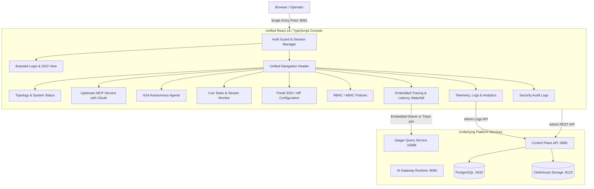
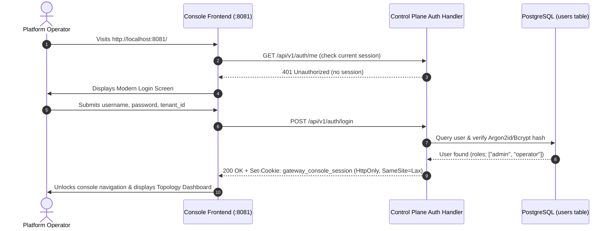
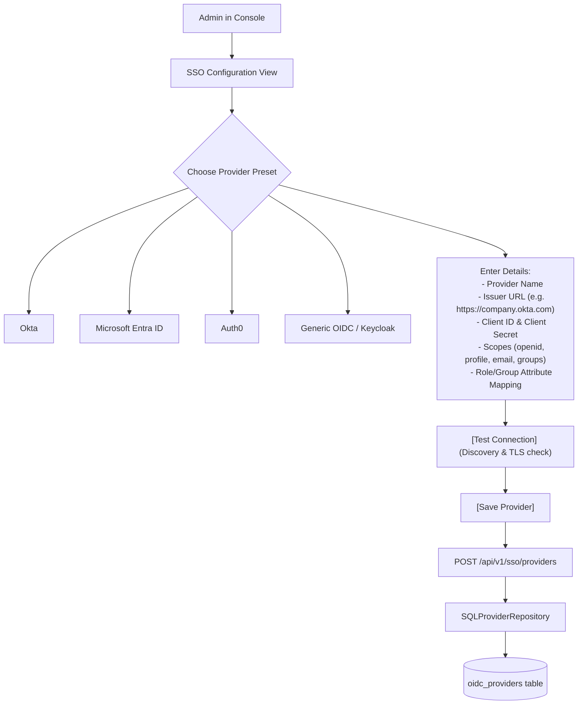
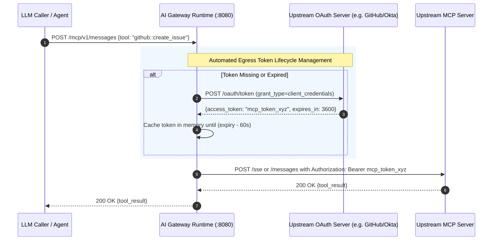

# AI Gateway Platform: Portal Security, SSO Configuration, MCP OAuth & Portal Unification Plan

This document details the architectural plan, technical specifications, and step-by-step implementation roadmap for:
1. **Protecting the AI Gateway Management Console** with username and password authentication.
2. **Self-Service Portal SSO Configuration** enabling operators to federate with any external Identity Provider (Okta, Auth0, Microsoft Entra ID, Google, Keycloak).
3. **Upstream MCP Server OAuth 2.0 Support** enabling secure integration with OAuth2-protected Model Context Protocol tools.
4. **Portal Unification ("Clouding Together")** consolidating disparate tools (Console, Jaeger UI, Login/Consent, Telemetry) into a single unified web experience.

---

## 1. Architectural Consultation: Portal Unification Strategy

### Current Fragmented Architecture
Currently, operators and developers encounter multiple fragmented endpoints across different ports:
- `http://localhost:8081`: Management Console (React Single Page Application)
- `http://localhost:16686`: Jaeger UI (Standalone distributed tracing web application)
- `http://localhost:8080/login` & `/consent`: Gateway Identity Provider pages (unstyled raw HTML)
- `http://localhost:8123/play`: ClickHouse Play (raw SQL query console)
- `http://localhost:9090/metrics`: Prometheus metrics exposition endpoint

### Target Unified Architecture
Consolidate all administrative and developer experiences under **a single unified portal** hosted by the Control Plane at `http://localhost:8081` (or reverse-proxied behind `:8080/console`):

#### Key Unification Benefits:
1. **Single Sign-On (SSO):** A single login session protects management views, telemetry analytics, and tool catalogs.
2. **Integrated Tracing:** The existing [TraceWaterfall.tsx](file:///c:/Users/Administrator/Downloads/project/project_alpha/web/src/components/TraceWaterfall.tsx) and an embedded Jaeger view are accessible within the same tabbed navigation without opening separate browser tabs.
3. **No Direct Database Exposure:** Operators query logs through the secure [LogSearch.tsx](file:///c:/Users/Administrator/Downloads/project/project_alpha/web/src/components/LogSearch.tsx) component rather than exposing raw ClickHouse Play on port `:8123`.
4. **Consistent Aesthetics:** Raw HTML login/consent forms are replaced with branded React components.

---

## 2. Feature 1: Console Username & Password Authentication

### 2.1 Overview & Request Flow
The Management Console will require authentication before any administration view is rendered.

### 2.2 Technical Specifications

#### Database & Initial Admin Credentials
- Table [users](file:///c:/Users/Administrator/Downloads/project/project_alpha/migrations/000008_users.up.sql) already exists with:
  - `id`, `tenant_id`, `username`, `email`, `password_hash`, `roles`, `active`.
- [dev-seed](file:///c:/Users/Administrator/Downloads/project/project_alpha/cmd/dev-seed/main.go) and bootstrap scripts will provision a default administrator account:
  - **Tenant ID:** `default`
  - **Username:** `admin`
  - **Password:** Configurable via environment variable `GATEWAY_ADMIN_INITIAL_PASSWORD` (defaults to a secure dev password with force-change prompt on first login).

#### Control Plane API Endpoints ([cmd/control-plane/main.go](file:///c:/Users/Administrator/Downloads/project/project_alpha/cmd/control-plane/main.go))
| Method | Endpoint | Description |
| :--- | :--- | :--- |
| `POST` | `/api/v1/auth/login` | Authenticates username & password; sets secure session cookie. |
| `POST` | `/api/v1/auth/logout` | Clears session cookie and invalidates session. |
| `GET` | `/api/v1/auth/me` | Returns current user identity, tenant, and assigned roles. |

#### Control Plane Auth Middleware
- Protects all `/api/v1/*` endpoints (excluding `/api/v1/auth/login`, `/healthz`, `/readyz`).
- Verifies session token or Bearer JWT and injects `Principal` into Go `context.Context`.

#### Frontend Components
- `web/src/components/LoginView.tsx`: Modern dark-mode login form with tenant selection, error feedback, and "Sign in with SSO" option.
- `web/src/context/AuthContext.tsx`: React Context managing user authentication state, auto session refresh, and logout handlers.
- Update [App.tsx](file:///c:/Users/Administrator/Downloads/project/project_alpha/web/src/App.tsx) with route guards.

---

## 3. Feature 2: Portal SSO / IdP Configuration Page

### 3.1 Overview & Request Flow
Once logged in as an administrator, operators can navigate to the **SSO & Identity** view to configure external Identity Providers using OpenID Connect (OIDC).

### 3.2 Technical Specifications

#### Database Layer
- Table [oidc_providers](file:///c:/Users/Administrator/Downloads/project/project_alpha/migrations/000007_oidc_providers.up.sql) already exists with:
  - `id`, `tenant_id`, `name`, `issuer_url`, `client_id`, `client_secret_hash`, `claim_mapping`, `active`.
- [SQLProviderRepository](file:///c:/Users/Administrator/Downloads/project/project_alpha/internal/identity/oidc/sql_repository.go) provides data access methods:
  - `SaveProvider(ctx, provider)`
  - `GetProvider(ctx, tenantID, id)`
  - `ListProviders(ctx, tenantID)`

#### Admin REST API Endpoints
| Method | Endpoint | Description |
| :--- | :--- | :--- |
| `GET` | `/api/v1/sso/providers` | Lists configured external IdPs for the tenant. |
| `POST` | `/api/v1/sso/providers` | Creates or updates an external IdP configuration. |
| `DELETE` | `/api/v1/sso/providers/:id` | Deletes or deactivates an IdP configuration. |
| `POST` | `/api/v1/sso/providers/:id/test` | Live test: downloads `/.well-known/openid-configuration` and checks endpoint connectivity. |

#### Frontend View: `web/src/components/SSOConfigView.tsx`
- **Provider Catalog:** Cards showing configured providers with status badges (`Active`, `Testing`, `Disabled`).
- **Configuration Modal / Drawer:**
  - Presets for Okta, Entra ID, Auth0, Google Workspace, and Custom OIDC.
  - Issuer URL, Client ID, Client Secret (masked input).
  - Claim Mapping Editor (e.g., mapping IdP `groups: ["platform-admins"]` to platform role `admin`).
  - Single-click **"Test Discovery"** button that validates the configuration before saving.
  - Toggle switch: **"Enable SSO on Console Login Screen"**.

---

## 4. Feature 3: Upstream MCP Server OAuth 2.0 Support

### 4.1 The Identified Gap
In [MCPServersView.tsx](file:///c:/Users/Administrator/Downloads/project/project_alpha/web/src/components/MCPServersView.tsx#L247-L305), the registration modal only requests server name, prefix, transport type, endpoint URL, timeout, and concurrency. **Authentication configuration is completely absent from the UI**, preventing upstream tools (like GitHub, Jira, Salesforce, AWS, or custom MCP servers) from authenticating via OAuth 2.0.

### 4.2 Upstream MCP OAuth Architecture

### 4.3 Technical Specifications

#### Authentication Modes to Support in UI & Gateway
1. **`NONE`**: Public or local stdio tools.
2. **`BEARER_TOKEN`**: Static Personal Access Tokens (PAT) or API keys.
3. **`BASIC`**: Username and password.
4. **`OAUTH2_CLIENT_CREDENTIALS`**: Automated Machine-to-Machine (M2M) upstream token acquisition:
   - **Token Endpoint URL:** (e.g., `https://oauth2.provider.com/token`)
   - **Client ID & Client Secret**
   - **Scopes:** Space-separated OAuth scopes required by the tool.
   - **Audience:** Optional resource audience identifier.
5. **`OAUTH2_TOKEN_EXCHANGE` (RFC 8693)**:
   - Exchanges the inbound caller's JWT token for a scoped downstream upstream token.

#### Data Persistence & Encryption
- In [000001_init_schema.up.sql](file:///c:/Users/Administrator/Downloads/project/project_alpha/migrations/000001_init_schema.up.sql#L56-L57), table `mcp_servers` already contains:
  - `auth_type TEXT NOT NULL DEFAULT 'NONE'`
  - `encrypted_auth_credentials BYTEA`
- Credentials will be JSON-serialized and encrypted using AES-256-GCM via the platform's `GATEWAY_ENCRYPTION_KEY`.

#### Gateway Egress Token Manager ([internal/mcp/upstream/](file:///c:/Users/Administrator/Downloads/project/project_alpha/internal/mcp/upstream/))
- Implements an automated token provider with:
  - In-memory thread-safe caching (`sync.RWMutex`).
  - Proactive background renewal before token expiry.
  - Automatic `Authorization: Bearer <token>` header injection on outbound HTTP/SSE requests.

#### Frontend Updates in [MCPServersView.tsx](file:///c:/Users/Administrator/Downloads/project/project_alpha/web/src/components/MCPServersView.tsx)
- Add **Authentication Type** dropdown to the registration modal.
- Conditionally render OAuth2 configuration fields when `OAUTH2_CLIENT_CREDENTIALS` is chosen:
  - Token Endpoint input field.
  - Client ID & Client Secret fields (password-masked).
  - Scopes input with helpful placeholder.
  - Audience input.
- Display an **Auth Badge** in the server table: `OAuth2 (M2M)`, `Bearer`, or `None`.

---

## 5. Detailed Implementation Phases & Milestones

### Phase 1: Management Console Authentication
- [ ] **1.1 Backend Auth Controller:**
  - Create `internal/api/admin/auth_handler.go` with `/api/v1/auth/login`, `/logout`, and `/me`.
  - Implement session cookie generator using signed HMAC or encrypted session tokens.
- [ ] **1.2 Auth Middleware:**
  - Add `AdminAuthMiddleware` in [cmd/control-plane/main.go](file:///c:/Users/Administrator/Downloads/project/project_alpha/cmd/control-plane/main.go) protecting `/api/v1/*`.
- [ ] **1.3 Seed Default Admin:**
  - Update [cmd/dev-seed/main.go](file:///c:/Users/Administrator/Downloads/project/project_alpha/cmd/dev-seed/main.go) to seed an initial administrator account.
- [ ] **1.4 Frontend Auth State & Login View:**
  - Build `web/src/components/LoginView.tsx`.
  - Implement `web/src/context/AuthContext.tsx`.
  - Wrap [App.tsx](file:///c:/Users/Administrator/Downloads/project/project_alpha/web/src/App.tsx) with the auth guard.
  - Add user profile dropdown & "Sign Out" button to [Navbar.tsx](file:///c:/Users/Administrator/Downloads/project/project_alpha/web/src/components/Navbar.tsx).

### Phase 2: Portal SSO / IdP Configuration
- [ ] **2.1 Admin SSO Endpoints:**
  - Implement `internal/api/admin/sso_handler.go` utilizing [SQLProviderRepository](file:///c:/Users/Administrator/Downloads/project/project_alpha/internal/identity/oidc/sql_repository.go).
  - Add connection test utility validating remote `.well-known/openid-configuration`.
- [ ] **2.2 Frontend SSO Settings:**
  - Create `web/src/components/SSOConfigView.tsx`.
  - Add "SSO & Identity" navigation link in [Navbar.tsx](file:///c:/Users/Administrator/Downloads/project/project_alpha/web/src/components/Navbar.tsx).
  - Connect provider creation, listing, editing, and live connection testing to API.
- [ ] **2.3 Console SSO Login Integration:**
  - Add "Sign in with SSO" button to `LoginView.tsx` redirecting to the configured IdP.

### Phase 3: Upstream MCP Server OAuth 2.0 Support
- [ ] **3.1 Frontend MCP Registration Modal:**
  - Expand [MCPServersView.tsx](file:///c:/Users/Administrator/Downloads/project/project_alpha/web/src/components/MCPServersView.tsx) to include Authentication Method selection and OAuth2 credential fields.
- [ ] **3.2 Backend MCP Credential Encryption:**
  - Update `internal/api/admin/mcp_handler.go` to validate and encrypt OAuth credentials before writing to `mcp_servers`.
- [ ] **3.3 Gateway Egress OAuth Token Provider:**
  - Implement `internal/mcp/upstream/oauth_token_provider.go` with automated token acquisition, caching, and auto-refresh.
  - Integrate with the gateway's SSRF-safe outbound HTTP dialer.

### Phase 4: Complete Portal Unification
- [ ] **4.1 Embedded Tracing Experience:**
  - Add a dedicated **"Tracing & Telemetry"** navigation tab embedding Jaeger UI or enhancing [TraceWaterfall.tsx](file:///c:/Users/Administrator/Downloads/project/project_alpha/web/src/components/TraceWaterfall.tsx) with search.
- [ ] **4.2 Unified OAuth Consent Dialog:**
  - Replace server-rendered HTML in [interactive_service.go](file:///c:/Users/Administrator/Downloads/project/project_alpha/internal/identity/idp/interactive_service.go) with a styled embedded React consent view.
- [ ] **4.3 Single-Port Gateway & Console Routing (Optional):**
  - Configure reverse-proxy routing so both data plane and console can be served from a single primary port with distinct path prefixes (`/` and `/console`).

---

## 6. Verification & Quality Gates
1. **Unit & Integration Tests:** Run `make test` to ensure all existing security, identity, and transport tests pass.
2. **Console Authentication Verification:** Verify unauthenticated users cannot access `/api/v1/*` or console views without valid credentials.
3. **SSO Discovery Test:** Verify that adding an Okta/Auth0/Google provider succeeds in querying the remote discovery document and saving mappings.
4. **MCP OAuth End-to-End Test:** Register a mock OAuth2-protected MCP server, execute a tool call, and verify that the gateway obtains and passes the Bearer token in the outbound request.
5. **Docker Compose Verification:** Run `make compose-up` to ensure all containers start cleanly in a healthy state.
