# Component Dependencies & Module Boundaries

## 1. Architectural Principles for Module Boundaries

To prevent coupling and maintain strict separation of concerns, the platform enforces the following dependency rules:

1. **Protocol Independence**: `internal/mcp` and `internal/a2a` must remain completely decoupled. Neither module may import or depend on the other. Shared capabilities (identity, telemetry, resilience, routing abstractions) live in common platform modules.
2. **Layered Architecture**: Higher-level protocol handlers depend on lower-level business logic and storage abstractions, never the reverse.
3. **Storage Decoupling**: Business domain modules (e.g., `mcp`, `a2a`, `identity`, `tenants`) interact with storage exclusively through Go interfaces defined in the domain packages. Implementations live in `internal/storage/postgres/` or `internal/storage/cache/`.
4. **Transport Isolation**: Protocol transport mechanics (HTTP SSE, JSON-RPC, WebSockets, stdio) are isolated within subpackages (`internal/mcp/transport`, `internal/a2a/protocol`) and do not leak into domain logic.
5. **Zero Circular Dependencies**: Enforced strictly at compile time by Go's package import model.

---

## 2. Monorepo Package Layout

```
AIGateway/
├── cmd/
│   ├── gateway/                  # Gateway binary entry point (MCP + A2A + Ingress)
│   ├── control-plane/            # Control plane administrative API & Console server
│   └── migrate/                  # Schema migration CLI tool
├── internal/
│   ├── api/                      # REST & JSON HTTP presentation layers
│   │   ├── admin/                # Tenant, policy, and registry management handlers
│   │   ├── middleware/           # Auth, tenant, trace, logging, rate-limit middleware
│   │   └── health/               # /healthz, /readyz, /startupz handlers
│   ├── mcp/                      # Model Context Protocol engine
│   │   ├── transport/            # SSE and stdio transport implementations
│   │   ├── session/              # Client session state and connection management
│   │   ├── discovery/            # Tool, prompt, resource aggregation & filtering
│   │   ├── aggregation/          # Namespace collision resolution and catalog synthesis
│   │   └── routing/              # Upstream dispatch and execution
│   ├── a2a/                      # Agent-to-Agent protocol engine
│   │   ├── protocol/             # Agent Card and A2A task protocol structures
│   │   ├── registry/             # Agent registration & capability lookup
│   │   ├── routing/              # Agent task routing & endpoint resolution
│   │   └── tasks/                # Asynchronous task state machine and streaming
│   ├── identity/                 # IAM, OAuth 2.1, and OIDC
│   │   ├── oauth/                # PKCE S256, Client Credentials grant handlers
│   │   ├── oidc/                 # OIDC discovery provider & external IdP client
│   │   ├── providers/            # Okta, Auth0, Entra ID claim mappers
│   │   ├── tokens/               # JWT creation, JWKS provider, validation, revocation
│   │   └── keys/                 # Key management (ECDSA P-256 / Ed25519)
│   ├── policy/                   # Authorization engine (RBAC + ABAC)
│   ├── tenants/                  # Tenant and project context management
│   ├── registry/                 # Common registry interfaces for upstreams & agents
│   ├── config/                   # Configuration parsing, environment binding & validation
│   ├── resilience/               # Circuit breakers, rate limiters, bulkheads, retry loops
│   ├── secrets/                  # AES-GCM encryption at rest, vault & env resolvers
│   ├── observability/            # OpenTelemetry integration
│   │   ├── instrumentation/      # HTTP/gRPC tracing & metrics interceptors
│   │   ├── ingestion/            # OTLP trace, metric, log receiver pipeline
│   │   ├── correlation/          # Trace-to-log correlation helpers
│   │   └── topology/             # Configured vs observed graph derivation
│   └── storage/                  # Persistence layer implementations
│       ├── postgres/             # pgx driver, query repositories, transactions
│       ├── cache/                # In-memory and Redis cache adapters
│       └── telemetry/            # ClickHouse and Prometheus storage adapters
├── web/
│   └── console/                  # React / TypeScript Management Console
├── migrations/                   # SQL migration scripts (golang-migrate compatible)
├── configs/                      # Default and example YAML configurations
└── docs/                         # Architecture, ADRs, Security, and Operations
```

---

## 3. Module Dependency Graph

```mermaid
graph TD
    subgraph "Application Entry Points (cmd/)"
        cmd_gw["cmd/gateway"]
        cmd_cp["cmd/control-plane"]
        cmd_mig["cmd/migrate"]
    end

    subgraph "Ingress & API (internal/api/)"
        api_mw["internal/api/middleware"]
        api_admin["internal/api/admin"]
        api_health["internal/api/health"]
    end

    subgraph "Protocol Engines (internal/)"
        mcp_mod["internal/mcp<br/>(transport, discovery, routing)"]
        a2a_mod["internal/a2a<br/>(protocol, registry, tasks)"]
    end

    subgraph "Shared Platform Services (internal/)"
        id_mod["internal/identity<br/>(oauth, oidc, tokens, keys)"]
        pol_mod["internal/policy<br/>(RBAC, ABAC)"]
        reg_mod["internal/registry"]
        res_mod["internal/resilience<br/>(circuit breaker, rate limit, retries)"]
        sec_mod["internal/secrets<br/>(AES-GCM encryption, redaction)"]
        cfg_mod["internal/config<br/>(validation, env)"]
        ten_mod["internal/tenants"]
    end

    subgraph "Observability Engine (internal/observability/)"
        obs_mod["internal/observability<br/>(instrumentation, ingestion, topology)"]
    end

    subgraph "Storage & Infrastructure (internal/storage/)"
        stg_pg["internal/storage/postgres"]
        stg_cache["internal/storage/cache"]
        stg_tel["internal/storage/telemetry"]
    end

    %% Entry point dependencies
    cmd_gw --> api_mw
    cmd_gw --> mcp_mod
    cmd_gw --> a2a_mod
    cmd_gw --> obs_mod
    cmd_gw --> cfg_mod

    cmd_cp --> api_admin
    cmd_cp --> api_health
    cmd_cp --> cfg_mod

    cmd_mig --> stg_pg

    %% API dependencies
    api_mw --> id_mod
    api_mw --> ten_mod
    api_mw --> obs_mod
    api_admin --> reg_mod
    api_admin --> pol_mod
    api_admin --> ten_mod

    %% Protocol engine dependencies
    mcp_mod --> pol_mod
    mcp_mod --> reg_mod
    mcp_mod --> res_mod
    mcp_mod --> sec_mod
    mcp_mod --> obs_mod
    mcp_mod --> ten_mod

    a2a_mod --> pol_mod
    a2a_mod --> reg_mod
    a2a_mod --> res_mod
    a2a_mod --> sec_mod
    a2a_mod --> obs_mod
    a2a_mod --> ten_mod

    %% Shared services dependencies
    id_mod --> ten_mod
    id_mod --> sec_mod
    pol_mod --> ten_mod

    %% Storage dependencies (implementations satisfy domain interfaces)
    stg_pg --> ten_mod
    stg_pg --> reg_mod
    stg_cache --> reg_mod
    stg_tel --> obs_mod
```



---

## 4. Prohibited Dependency Violations

| Source Package | Prohibited Target | Rationale |
| :--- | :--- | :--- |
| `internal/mcp` | `internal/a2a` | MCP and A2A are independent protocol specifications; sharing protocol logic creates tight coupling. |
| `internal/a2a` | `internal/mcp` | Cross-protocol calls must go through standard client transports or shared platform services. |
| `internal/identity` | `internal/mcp` or `internal/a2a` | Core authentication must remain agnostic of downstream protocol payloads. |
| `internal/storage/postgres` | `internal/mcp` or `internal/a2a` | Persistence layers must implement generic repository interfaces, not reference transport domain code. |
| `internal/resilience` | Any protocol package | Resilience primitives (circuit breaker, backoff, rate limiter) must be pure utility components. |
| `internal/config` | Any internal domain module | Configuration models are dependencies of domain modules, never the reverse. |
