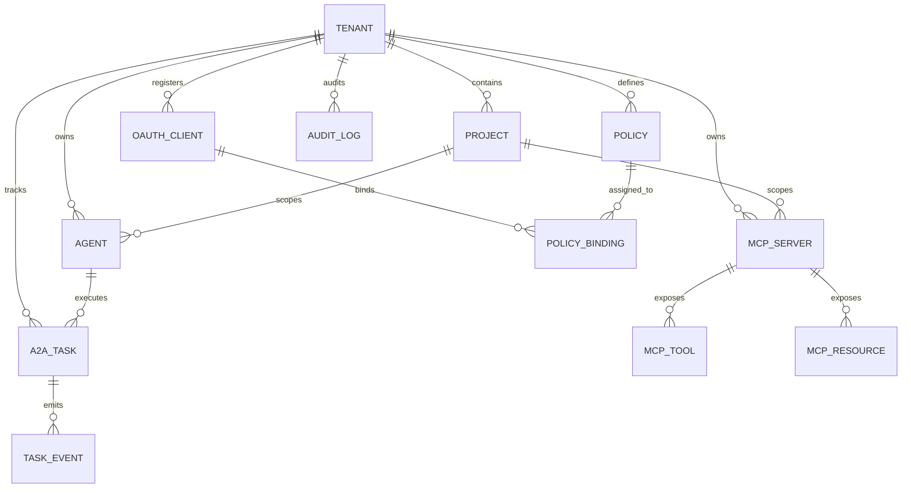
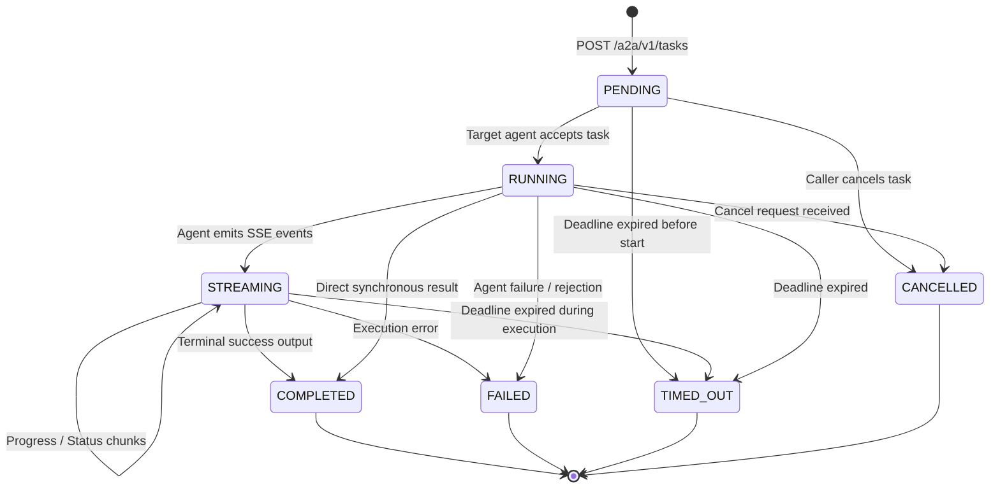

# Domain Model & Persistence Architecture

## 1. Core Domain Model Entities

The platform domain is structured around strict multi-tenancy. Every domain entity is anchored to a `Tenant` and optional `Project`.

---

## 2. Entity Specifications

### 2.1 Multi-Tenancy & Identity

#### `Tenant`
The root administrative boundary. All isolation mechanisms (DB queries, cache keys, telemetry namespaces) resolve to a `tenant_id`.
- `id` (UUIDv7 / text): Unique tenant identifier.
- `name` (varchar): Human-readable organization name.
- `slug` (varchar, unique): URL-safe identifier (e.g., `acme-corp`).
- `status` (enum): `ACTIVE`, `SUSPENDED`, `DELETED`.
- `tier` (varchar): Service tier governing default rate limits and concurrency quotas.
- `created_at`, `updated_at` (timestamptz).

#### `Project`
Sub-partition within a tenant to organize environments (e.g., `dev`, `staging`, `prod`) or autonomous teams.
- `id` (UUIDv7 / text): Unique project identifier.
- `tenant_id` (UUIDv7, FK): Parent tenant reference.
- `name` (varchar): Project display name.
- `slug` (varchar): Unique per tenant.

#### `OAuthClient`
Confidential machine or public client application requesting access to the Gateway.
- `id` (UUIDv7 / text): Primary key.
- `tenant_id` (UUIDv7, FK): Owning tenant.
- `client_id` (varchar, unique): Client public identifier.
- `client_secret_hash` (varchar, nullable): Argon2id or bcrypt hash of secret for confidential clients.
- `client_type` (enum): `CONFIDENTIAL`, `PUBLIC` (SPA/CLI using PKCE S256).
- `allowed_grant_types` (text[]): `authorization_code`, `client_credentials`, `refresh_token`.
- `redirect_uris` (text[]): Permitted redirect URIs.
- `allowed_scopes` (text[]): Set of permitted OAuth scopes.
- `token_endpoint_auth_method` (varchar): `client_secret_basic`, `client_secret_post`, `private_key_jwt`, `none`.

#### `IdPConfiguration`
External federated Identity Provider configuration (e.g., Okta, Auth0, Microsoft Entra ID).
- `id` (UUIDv7, PK): Unique configuration ID.
- `tenant_id` (UUIDv7, FK): Owning tenant.
- `issuer_url` (varchar): OIDC issuer URL (e.g., `https://dev-123.okta.com`).
- `client_id` (varchar): Client ID for platform application in external IdP.
- `encrypted_client_secret` (bytea): AES-256-GCM encrypted client secret.
- `claim_mapping` (jsonb): JSON mapping external claims to internal roles/tenants.
- `status` (enum): `ACTIVE`, `INACTIVE`.

---

### 2.2 MCP Gateway Domain

#### `MCPServer`
Upstream MCP server registration registered with the Gateway.
- `id` (UUIDv7, PK): Stable internal identifier.
- `tenant_id` (UUIDv7, FK): Owning tenant.
- `project_id` (UUIDv7, FK, nullable): Scoping project.
- `name` (varchar): Canonical server name (e.g., `github-service`, `postgres-data`).
- `namespace_prefix` (varchar): Prefix for disambiguating tool names (e.g., `gh_` or `db_`).
- `transport_type` (enum): `SSE`, `HTTP_POST`, `STDIO` (local).
- `endpoint_url` (varchar): Target URL (for remote upstreams).
- `command` (text, nullable): Binary/script command (for stdio upstreams).
- `auth_type` (enum): `NONE`, `BEARER_TOKEN`, `BASIC`, `HEADER`, `MUTUAL_TLS`.
- `encrypted_auth_credentials` (bytea): AES-256-GCM encrypted authentication tokens/keys.
- `timeout_ms` (integer): Request timeout limit in milliseconds (bounded, default: 10000ms).
- `concurrency_limit` (integer): Bulkhead maximum concurrent in-flight requests (default: 50).
- `health_status` (enum): `HEALTHY`, `DEGRADED`, `UNHEALTHY`, `UNKNOWN`.
- `last_health_check_at` (timestamptz).

#### `MCPTool` (Cached Tool Catalog)
- `id` (UUIDv7, PK): Primary key.
- `server_id` (UUIDv7, FK): Upstream server reference.
- `tenant_id` (UUIDv7, FK): Owning tenant.
- `canonical_name` (varchar): Name defined by upstream server (e.g., `query_database`).
- `qualified_name` (varchar): Disambiguated gateway tool name (e.g., `postgres-data::query_database`).
- `description` (text): Tool purpose and usage description.
- `input_schema` (jsonb): JSON Schema defining arguments.
- `updated_at` (timestamptz).

---

### 2.3 A2A Gateway Domain

#### `Agent`
Registered autonomous agent in the network.
- `id` (UUIDv7, PK): Unique agent identifier.
- `tenant_id` (UUIDv7, FK): Owning tenant.
- `project_id` (UUIDv7, FK, nullable): Scoping project.
- `name` (varchar): Agent display name (e.g., `code-reviewer-agent`).
- `endpoint_url` (varchar): Base URL for dispatching tasks.
- `agent_card` (jsonb): Complete published Agent Card describing capabilities, skills, and protocols.
- `protocol_version` (varchar): Supported A2A specification version (e.g., `a2a/v1`).
- `auth_type` (enum): `BEARER_TOKEN`, `MUTUAL_TLS`.
- `encrypted_auth_credentials` (bytea): AES-256-GCM encrypted tokens.
- `health_status` (enum): `HEALTHY`, `UNHEALTHY`.

#### `A2ATask`
Persistent task state machine record.
- `id` (UUIDv7, PK): Globally unique task identifier.
- `tenant_id` (UUIDv7, FK): Owning tenant.
- `caller_client_id` (varchar): Identity of originating caller or agent.
- `target_agent_id` (UUIDv7, FK): Target agent performing task.
- `idempotency_key` (varchar, nullable): Unique client-provided deduplication key.
- `status` (enum): `PENDING`, `RUNNING`, `STREAMING`, `COMPLETED`, `FAILED`, `TIMED_OUT`, `CANCELLED`.
- `deadline` (timestamptz): Hard execution deadline.
- `input_payload` (jsonb): Task arguments provided by caller.
- `output_payload` (jsonb, nullable): Terminal result payload.
- `error_code` (varchar, nullable): Error classification code.
- `error_message` (text, nullable): Sanitized error message.
- `trace_id` (varchar): Root distributed trace ID for correlation.
- `created_at`, `updated_at`, `completed_at` (timestamptz).

#### `TaskEvent`
Ordered execution event history for streaming and durability.
- `id` (UUIDv7, PK): Event identifier.
- `task_id` (UUIDv7, FK): Owning task.
- `sequence_num` (bigint): Monotonically increasing sequence number per task.
- `event_type` (enum): `STATUS_CHANGE`, `PROGRESS`, `STREAM_CHUNK`, `ERROR`, `HEARTBEAT`.
- `payload` (jsonb): Event-specific data.
- `created_at` (timestamptz).

---

### 2.4 Policy & Authorization Domain

#### `Policy`
RBAC and ABAC policy definitions.
- `id` (UUIDv7, PK): Primary key.
- `tenant_id` (UUIDv7, FK): Owning tenant.
- `name` (varchar): Policy name (e.g., `read-only-developer-tools`).
- `effect` (enum): `ALLOW`, `DENY`.
- `actions` (text[]): e.g., `["mcp:tools:discover", "mcp:tools:call", "a2a:tasks:submit", "a2a:agents:read"]`.
- `resources` (text[]): Resource URI patterns (e.g., `["mcp:tools:github-service::*", "a2a:agents:code-reviewer"]`).
- `conditions` (jsonb, nullable): ABAC attribute rules (e.g., `{"department": "engineering", "environment": "dev"}`).

---

### 2.5 Security & Auditing Domain

#### `AuditLog`
Immutable audit log of all security-sensitive actions and administrative operations.
- `id` (UUIDv7, PK): Primary key.
- `tenant_id` (UUIDv7, FK): Owning tenant.
- `actor_id` (varchar): Identity performing action (user email or client ID).
- `actor_type` (enum): `USER`, `SERVICE_ACCOUNT`, `ANONYMOUS`.
- `action` (varchar): e.g., `mcp.tool.invoke`, `a2a.task.submit`, `policy.update`, `oauth.token.issue`.
- `resource_id` (varchar): Target resource identifier.
- `outcome` (enum): `SUCCESS`, `DENIED`, `ERROR`.
- `client_ip` (inet): Caller IP address.
- `user_agent` (varchar): Caller user agent.
- `trace_id` (varchar): Correlated trace ID.
- `metadata` (jsonb): Sanitized context details.
- `timestamp` (timestamptz).

---

## 3. A2A Task State Machine

### State Transition Invariants
1. **Terminal State Immutability**: Once a task enters `COMPLETED`, `FAILED`, `TIMED_OUT`, or `CANCELLED`, its state cannot be updated.
2. **Monotonic Sequences**: `TaskEvent` records are strictly ordered by `sequence_num` using database transactions or optimistic locking.
3. **Automatic Expiry**: Background reaper scans for in-flight tasks where `now() > deadline` and marks them `TIMED_OUT`.
