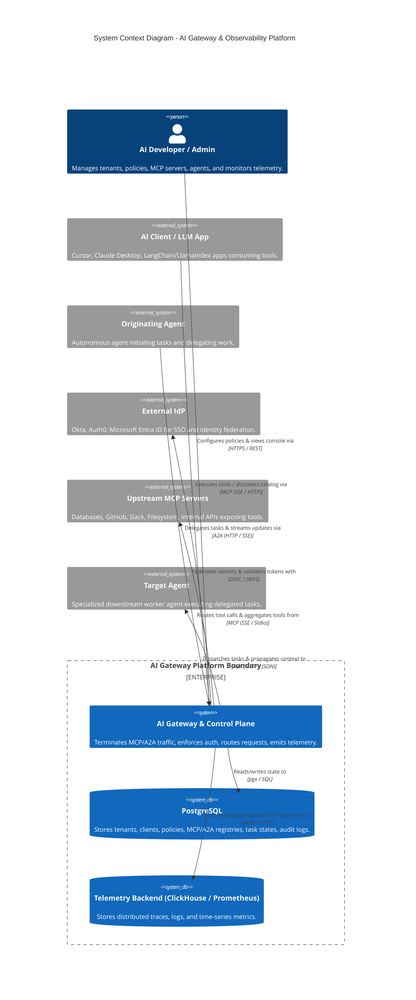
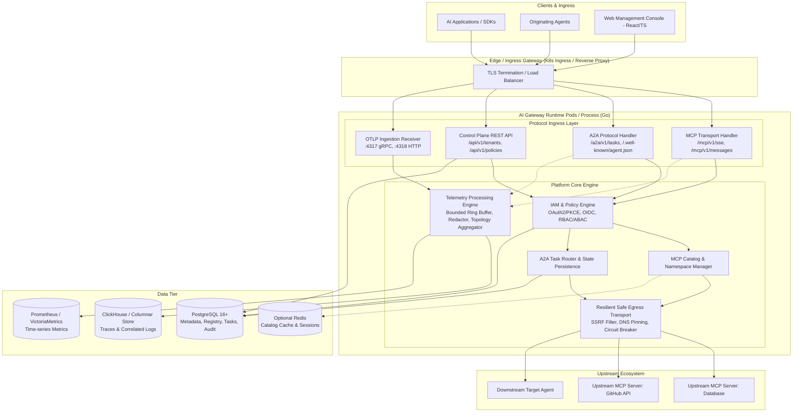

# Architecture Overview: AI Gateway & Observability Platform

## 1. System Vision & Context

The **AI Gateway & Observability Platform** is a secure, high-performance control plane and proxy designed for enterprise AI systems. It unifies two critical emerging protocols in the autonomous AI landscape under a governed, multi-tenant perimeter:

1. **Model Context Protocol (MCP)**: Aggregates heterogeneous upstream MCP tool, prompt, and resource servers into a single, authenticated logical gateway endpoint.
2. **Agent-to-Agent (A2A) Protocol**: Enables discovery, routing, delegation, task lifecycle coordination, and context propagation between autonomous agents across tenant and organizational boundaries.

Surrounding these protocol gateways are core enterprise platform services:
- **Identity & Access Management (IAM)**: Built-in OAuth 2.1 / OIDC identity provider, client credentials engine, external IdP federation (Okta, Auth0, Microsoft Entra ID), and fine-grained RBAC/ABAC authorization.
- **OpenTelemetry Observability Engine**: End-to-end W3C Trace Context propagation, distributed tracing, metrics, correlated structured logging, and automated topology discovery (distinguishing configured vs. observed interactions).
- **Resilience & Safe Outbound Egress**: Hardened network transports preventing SSRF and DNS rebinding, bulkheads, circuit breakers, bounded retries with jitter, and non-blocking telemetry pipelines.

---

## 2. System Context Diagram (C4 Level 1)

---

## 3. Container Architecture (C4 Level 2)

The system is designed as a **modular monolith** with clean operational separation. In standalone environments, services run within a unified process or Docker Compose stack. In Kubernetes environments, workloads scale independently based on resource profiles:

---

## 4. Key Request Flows

### 4.1 MCP Client Tool Execution Flow

1. **Authentication & Ingress**: The client connects to `POST /mcp/v1/messages` (or initializes SSE stream at `/mcp/v1/sse`) providing a Bearer JWT.
2. **Context & Tenant Extraction**: The Gateway validates the JWT signature (via built-in JWKS or cached external IdP keys), extracts the `tenant_id`, client scopes, and user claims. A W3C trace span is initialized.
3. **Dual-Phase Authorization**:
   - **Phase 1 (Discovery)**: When `tools/list` is requested, the policy engine filters available tools based on RBAC/ABAC rules. Tool names are disambiguated using configured namespaces (`<upstream_id>::<tool_name>`).
   - **Phase 2 (Execution)**: When `tools/call` is executed, the gateway performs strict invocation authorization. Visibility in the catalog does **not** grant execution rights.
4. **Resilient Safe Egress**:
   - The Gateway checks the upstream server's circuit breaker and concurrency limit (bulkhead).
   - The outbound request is dispatched through the SSRF-safe dialer (validating destination IP against private CIDR blocks).
   - If downstream authentication is configured, the gateway attaches the server's dedicated client credentials or performs token exchange (downstream token exchange).
5. **Telemetry & Audit**: The tool call duration, input/output payload size (with sensitive parameter redaction), upstream status code, and error codes are recorded into the active span and queued for telemetry ingestion.

### 4.2 A2A Task Delegation Flow

1. **Agent Discovery**: The originating agent inspects the target agent's Agent Card via `GET /a2a/v1/agents/{agent_id}/card`.
2. **Task Creation**: The caller submits `POST /a2a/v1/tasks` with input parameters, deadline, and trace context (`traceparent`, `tracestate`).
3. **Persistence & Idempotency**: The gateway verifies client permissions, stores the task record in PostgreSQL in `PENDING` state with an idempotency key, and records the initial state transition event.
4. **Dispatch & Routing**: The task is routed to the target agent endpoint. If SSE streaming is requested, the gateway bridges the downstream SSE event stream back to the caller while persisting milestone progress events.
5. **Terminal State Recording**: Upon completion, the task transition to `COMPLETED` or `FAILED` is committed with execution metrics and audit events.

### 4.3 Non-Blocking Telemetry Ingestion Pipeline

1. **OTLP Ingestion**: Gateway instrumentation and external agents push OTLP traces (`/v1/traces`), metrics (`/v1/metrics`), and logs (`/v1/logs`) to the gateway receiver.
2. **Tenant Attribution & Redaction**: Telemetry records are tagged with the verified `tenant_id` and passed through a sensitive data redactor (stripping authorization headers, secret keys, API tokens).
3. **Bounded Ring Buffer**: Events are pushed into an in-memory ring buffer with a configured maximum queue size.
4. **Load Shedding Under Pressure**: If telemetry backends (ClickHouse/Prometheus) experience degradation or downtime, the buffer sheds telemetry events using a priority drop policy. **The gateway never blocks or fails user traffic due to telemetry storage outages.**

---

## 5. Trust Boundaries & Tenant Isolation

| Trust Boundary | Protection Mechanism | Isolation Guarantee |
| :--- | :--- | :--- |
| **External Client $\rightarrow$ Gateway** | TLS 1.3, OAuth 2.1 (PKCE S256), Client Credentials, Rate Limiter | Untrusted external network terminated at edge. No unauthenticated requests enter internal domain. |
| **Tenant $\leftrightarrow$ Tenant** | Logical partitioning via mandatory `tenant_id` on all DB rows, cache keys, telemetry queries, and routing tables | Complete tenant isolation. Cross-tenant access attempts trigger security audit alerts and immediate `403 Forbidden`. |
| **Gateway $\rightarrow$ Upstream MCP Servers** | SSRF protection dialer (RFC 1918/4193 deny-list, loopback block, DNS rebinding validation), Upstream credential vault | Upstream servers are treated as semi-trusted external entities. Upstream cannot pivot to cloud metadata (169.254.169.254) or internal services. |
| **Gateway $\rightarrow$ A2A Agents** | Mutual TLS / Signed JWT Bearer tokens, Agent Card schema validation, Deadlines & Concurrency bulkheads | Malicious or slow agents cannot exhaust gateway file descriptors or thread pools. |
| **Control Plane $\rightarrow$ Database / Secrets** | Scoped SQL transactions, parameterized queries (pgx), AES-256-GCM encrypted secrets at rest | Credentials, tokens, and secrets are never stored in plaintext or exposed in log outputs. |

---

## 6. Deployment Topology & Scalability

The platform provides a single binary that supports two operational profiles:

1. **Standalone Profile (`standalone`)**:
   - Single process or simple Docker Compose deployment.
   - Combines the MCP gateway, A2A gateway, control-plane REST API, and telemetry ingestion.
   - Ideal for local development, edge gateways, or single-tenant enterprise clusters.
2. **Distributed / Clustered Profile (`k8s`)**:
   - Independent deployment targets using shared Go code:
     - `gateway`: Stateless proxy replicas scaling horizontally on CPU/network I/O.
     - `control-plane`: Administrative API and management console backend.
     - `ingestion-worker`: OpenTelemetry aggregation and storage writer.
   - Stateless gateway replicas share durable state in PostgreSQL (and optional Redis for distributed rate-limiting and catalog cache).
   - Supports Kubernetes HPA (Horizontal Pod Autoscaler), graceful termination with connection draining, and zero-downtime rolling upgrades.
